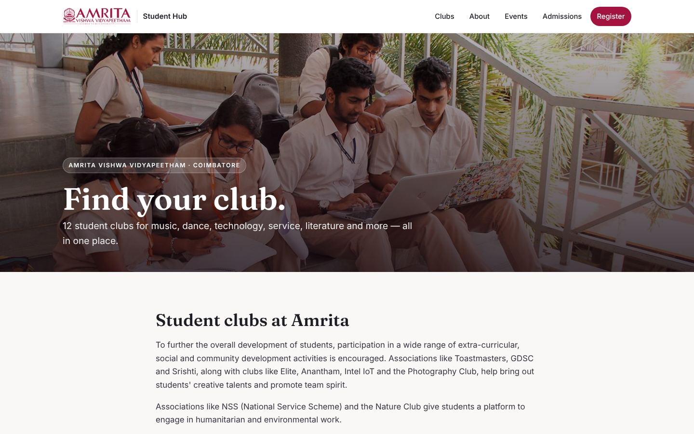
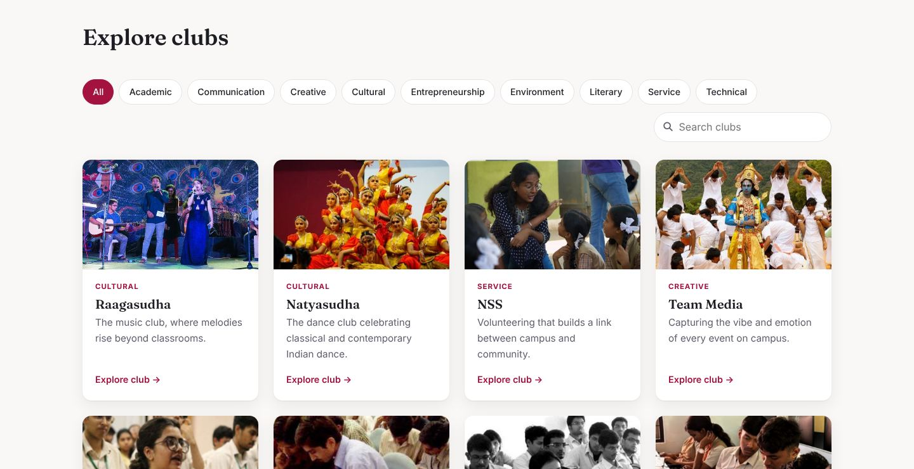
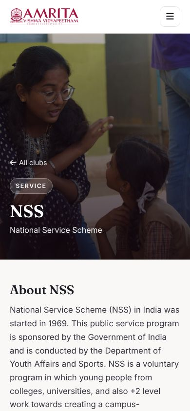
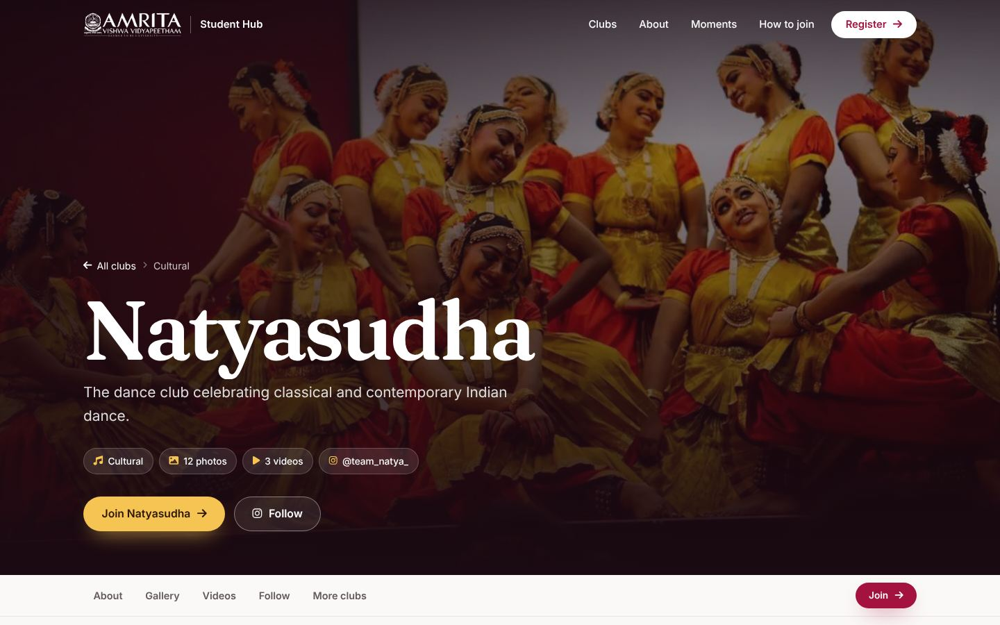
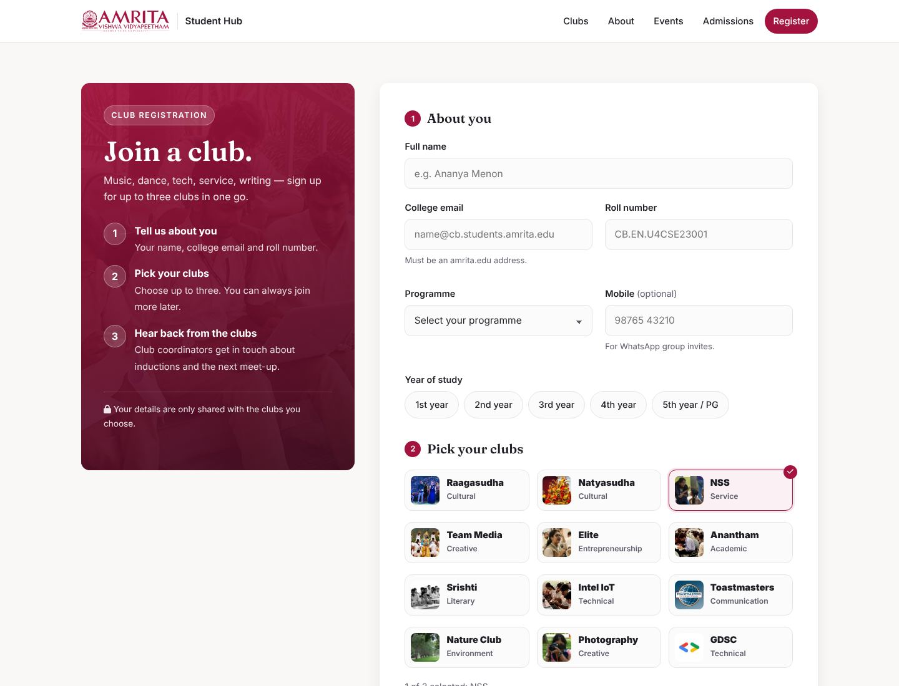
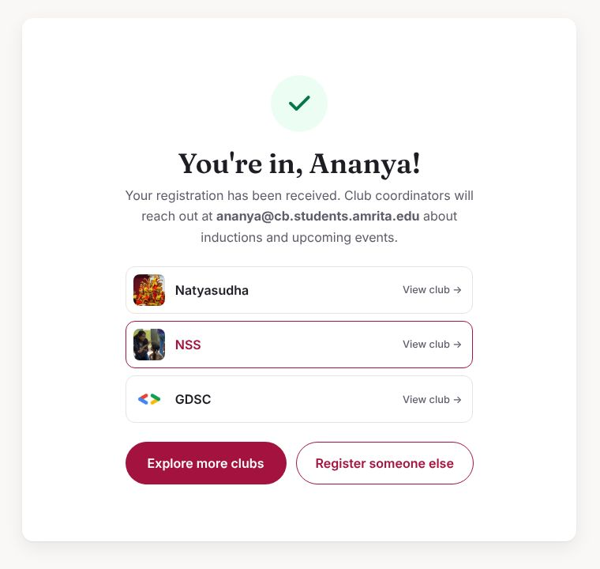
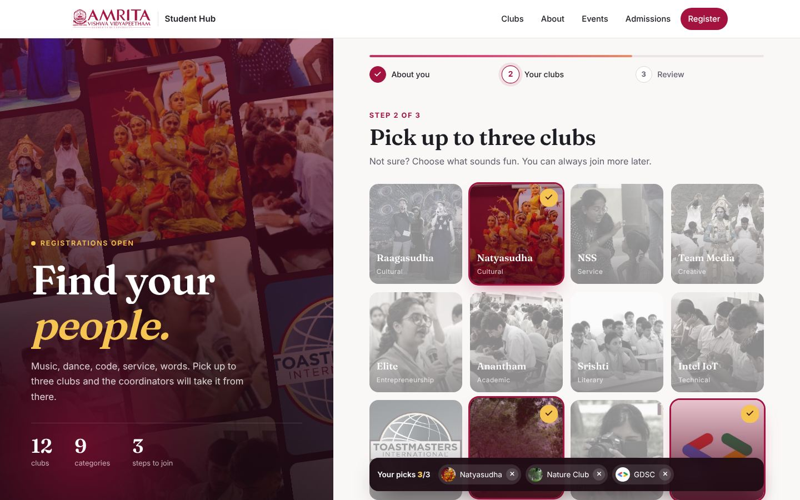

<div align="center">


# AMRITA Student Hub

**Every student club at Amrita Vishwa Vidyapeetham, Coimbatore, in one place.**

Browse 12 clubs, filter them by interest, open each club's page for its story, events, photos, videos and socials, and sign up for up to three clubs from one form.

[](#tech-stack)
[](#tech-stack)
[](#tech-stack)
[](#editing-content)
[](LICENSE)

[](https://vercel.com/new/clone?repository-url=https%3A%2F%2Fgithub.com%2Fparvathy2907%2Famrita-student-hub&project-name=amrita-student-hub)

[**View the live site**](https://parvathy2907.github.io/amrita-student-hub/) · [Report a bug](https://github.com/parvathy2907/amrita-student-hub/issues) · [Suggest a club](https://github.com/parvathy2907/amrita-student-hub/issues)



</div>

---

## Contents

- [About the project](#about-the-project)
- [Features](#features)
- [Screenshots](#screenshots)
- [Clubs](#clubs)
- [Tech stack](#tech-stack)
- [Getting started](#getting-started)
- [Editing content](#editing-content)
- [Project structure](#project-structure)
- [Deploying](#deploying)
- [Roadmap](#roadmap)
- [Contributing](#contributing)
- [License](#license)

## About the project

Information about student clubs at Amrita is scattered across Instagram pages, notice boards and word of mouth, so new students often don't know what's out there. AMRITA Student Hub brings it all together. It started as a **User Interface Design** course project and has since been rebuilt with a cleaner design, faster pages and content that is easy to update.

## Features

| | |
|---|---|
| ✨ **Immersive home page** | Full-screen hero over a moving wall of club photos, headline reveal, count-up stats, a scrolling ribbon of club names, and "Moments" photo ribbons |
| 🔎 **Find clubs fast** | Category filters with a sliding highlight, live search, and cards that animate in as you filter |
| 🖼️ **Rich club pages** | Parallax hero, sticky section tabs, an "at a glance" card, highlight stories, a masonry gallery with a full-screen viewer (keyboard and swipe), videos, social cards and related clubs |
| 📝 **Club registration** | A three-step animated sign-up: details, a visual club picker (up to three) and a review step, finishing with confetti and a personalised member pass |
| 📱 **Mobile first** | Full-screen animated menu, touch-friendly layouts, swipeable gallery |
| 🎞️ **Thoughtful motion** | Scroll-triggered reveals, a header that hides on scroll down and returns on scroll up, a reading-progress bar and a back-to-top button. Animations switch off for people who prefer reduced motion |
| ♿ **Accessible** | Skip link, focus styles, keyboard support everywhere, alt text, ARIA labels, and a branded 404 page |
| ⚡ **Lightweight** | No frameworks. Compressed media, lazy-loaded images, videos that play only on screen, self-hosted fonts, and versioned CSS/JS so updates show up instantly |
| 🧩 **Easy to update** | All text lives in one JSON file; one command rebuilds every page |

## Screenshots

<table>
  <tr>
    <td width="70%"></td>
    <td width="30%" rowspan="2" valign="top"></td>
  </tr>
  <tr>
    <td></td>
  </tr>
  <tr>
    <td></td>
    <td></td>
  </tr>
  <tr>
    <td colspan="2"></td>
  </tr>
  <tr>
    <td align="center"><sub>Club directory, a club page and the registration form</sub></td>
    <td align="center"><sub>On mobile, and after registering</sub></td>
  </tr>
</table>

## Clubs

| Club | Category | What it's about |
|---|---|---|
| [Raagasudha](clubs/raagasudha/) | Cultural | Music club — vocals, instruments and bands |
| [Natyasudha](clubs/natyasudha/) | Cultural | Classical and contemporary Indian dance |
| [NSS](clubs/nss/) | Service | National Service Scheme — community volunteering |
| [Team Media](clubs/team-media/) | Creative | Photography, cinematography and editing for campus events |
| [Elite](clubs/elite/) | Entrepreneurship | Entrepreneurship, leadership and start-up culture |
| [Anantham](clubs/anantham/) | Academic | The Mathematics Club |
| [Srishti](clubs/srishti/) | Literary | Poetry, debates, quizzes and regional-language literature |
| [Intel IoT](clubs/intel-iot/) | Technical | Hands-on IoT and AI with Intel tools |
| [Toastmasters](clubs/toastmasters/) | Communication | Public speaking and leadership |
| [Nature Club](clubs/nature/) | Environment | Conservation, animal welfare and a greener campus |
| [Photography](clubs/photography/) | Creative | Photo walks, contests and exhibitions |
| [GDSC](clubs/gdsc/) | Technical | Google Developer Student Club |

## Tech stack

- **HTML5 and CSS3** — semantic markup, CSS custom properties, Grid and Flexbox
- **Vanilla JavaScript** — about 100 lines in [`assets/js/main.js`](assets/js/main.js), no frameworks
- **Python 3** — a small, dependency-free [build script](scripts/build.py) that turns [`data/clubs.json`](data/clubs.json) into HTML pages
- **[GSAP](https://gsap.com/)** — animations on the Raagasudha page
- **[Inter](https://rsms.me/inter/), [Fraunces](https://fonts.google.com/specimen/Fraunces) and [Font Awesome](https://fontawesome.com/)** — self-hosted fonts and icons
- **Vercel / GitHub Pages** — hosting

## Getting started

You only need a browser. To run it locally:

```bash
git clone https://github.com/parvathy2907/amrita-student-hub.git
cd amrita-student-hub
python3 -m http.server 8000
```

Then open <http://localhost:8000>. Any static file server works (VS Code Live Server, `npx serve`, and so on).

## Editing content

The pages are **generated**. Edit the data, not the HTML.

1. Open [`data/clubs.json`](data/clubs.json) and change what you need.
2. Put any new photos or videos in `clubs/<slug>/`.
3. Rebuild:

   ```bash
   python3 scripts/build.py
   ```

<details>
<summary><b>Adding a new club</b> (example entry)</summary>

```json
{
  "slug": "robotics",
  "name": "Robotics Club",
  "full_name": "Amrita Robotics Club",
  "category": "Technical",
  "tagline": "Build, code and race robots.",
  "card": "robotics.jpg",
  "hero": "hero.jpg",
  "about": ["First paragraph…", "Second paragraph…"],
  "highlights": [
    {
      "title": "RoboWars 2025",
      "date": "12 March 2025",
      "images": ["robowars.jpg"],
      "sections": [{ "heading": "Results", "text": "…" }],
      "quote": "Optional pull quote"
    }
  ],
  "gallery": ["photo1.jpg", "photo2.jpg"],
  "videos": ["promo.mp4"],
  "socials": [
    { "type": "instagram", "label": "@robotics_amrita", "url": "https://instagram.com/…" }
  ]
}
```

- `card` goes in `assets/img/cards/`; everything else goes in `clubs/<slug>/`.
- For each video, add a `<name>-poster.jpg` preview image next to it.
- `socials.type` can be `instagram`, `facebook`, `youtube`, `linkedin`, `x` or `globe`.
- Optional fields: `full_name`, `highlights`, `pillars`, `videos`, `socials`.
- Add `"custom_page": true` to keep a hand-written page (as Raagasudha does).

</details>

<details>
<summary><b>Compressing media before you add it</b></summary>

Keep the site fast by shrinking files first:

```bash
# Photos: max 1400px wide
mogrify -resize '1400x1400>' -quality 80 clubs/<slug>/*.jpg

# Videos: 720p, no audio, web-optimised, plus a poster frame
ffmpeg -i input.mp4 -vf "scale='min(720,iw)':-2" -c:v libx264 -crf 30 -an -movflags +faststart clubs/<slug>/clip.mp4
ffmpeg -ss 1 -i clubs/<slug>/clip.mp4 -frames:v 1 clubs/<slug>/clip-poster.jpg
```

</details>

<details>
<summary><b>Collecting registrations</b></summary>

The site is static, so out of the box the form runs in **demo mode**: it validates the answers and shows the confirmation, but doesn't store them. To collect real sign-ups, point it at any service that accepts a JSON `POST`, such as [Formspree](https://formspree.io), [Getform](https://getform.io), a Google Apps Script web app writing to a Google Sheet, or your own API:

1. In `scripts/build.py`, find `<form id="register-form" novalidate>` and add your endpoint:
   ```html
   <form id="register-form" novalidate data-endpoint="https://formspree.io/f/your-id">
   ```
2. Run `python3 scripts/build.py`, then commit and push.

Each submission includes `name`, `email`, `roll`, `programme`, `year`, `phone`, `clubs`, `why` and `submittedAt`. Club pages link to `register/?club=<slug>`, so that club is ticked when the form opens.

</details>

## Project structure

```
amrita-student-hub/
├── index.html               # Home page (generated)
├── 404.html                 # Not-found page (generated)
├── register/index.html      # Club registration form (generated)
├── data/
│   └── clubs.json           # All club content
├── scripts/
│   └── build.py             # Generates index.html and clubs/*/index.html
├── clubs/
│   ├── <slug>/              # One folder per club: index.html + photos and videos
│   └── raagasudha/          # Hand-built page with GSAP animations
├── assets/
│   ├── css/style.css        # Shared styles
│   ├── js/main.js           # Header, menu, scroll reveals, filters, gallery viewer, videos
│   ├── css/register.css     # Registration page styles and animations
│   ├── js/register.js       # Three-step registration, confetti, member pass
│   ├── img/                 # Logo, favicon, hero, club cards and Moments thumbnails
│   └── vendor/              # Self-hosted fonts and icons
├── docs/screenshots/        # Images used in this README
└── vercel.json              # Vercel settings (clean URLs, caching)
```

## Deploying

The site is fully static: no build step and no server. The pages are already built and committed.

### Vercel (recommended)

[](https://vercel.com/new/clone?repository-url=https%3A%2F%2Fgithub.com%2Fparvathy2907%2Famrita-student-hub&project-name=amrita-student-hub)

Click the button, or on [vercel.com/new](https://vercel.com/new) import this repo and leave **Framework Preset** as *Other* with no build command. [`vercel.json`](vercel.json) sets clean URLs and caching for images, videos and fonts. Every push to `main` then redeploys automatically.

### GitHub Pages

Go to **Settings → Pages → Deploy from a branch**, then pick **`main`** and **`/ (root)`**. The site will be at `https://<username>.github.io/amrita-student-hub/`.

## Roadmap

- [x] Responsive redesign with a shared design system
- [x] Club filters and search
- [x] Gallery viewer and on-screen video playback
- [x] Data-driven pages from a single JSON file
- [x] Animated three-step club registration
- [x] Full redesign with scroll animations, parallax and a 404 page
- [ ] Store registrations in a database and email coordinators
- [ ] Login with college email IDs
- [ ] Feedback forms
- [ ] Events calendar across all clubs
- [ ] Backend (Django or Node.js) with an admin panel so clubs can manage their own pages

## Contributing

Suggestions and fixes are welcome, especially from club members who can keep their club's information current.

1. Fork the repo and create a branch: `git checkout -b update-nss-events`
2. Edit `data/clubs.json`, then run `python3 scripts/build.py`
3. Commit and open a pull request

## License

The code is released under the [MIT License](LICENSE).

Club names, logos and photos belong to their clubs and to Amrita Vishwa Vidyapeetham. This is a student project and **not an official university website**.
